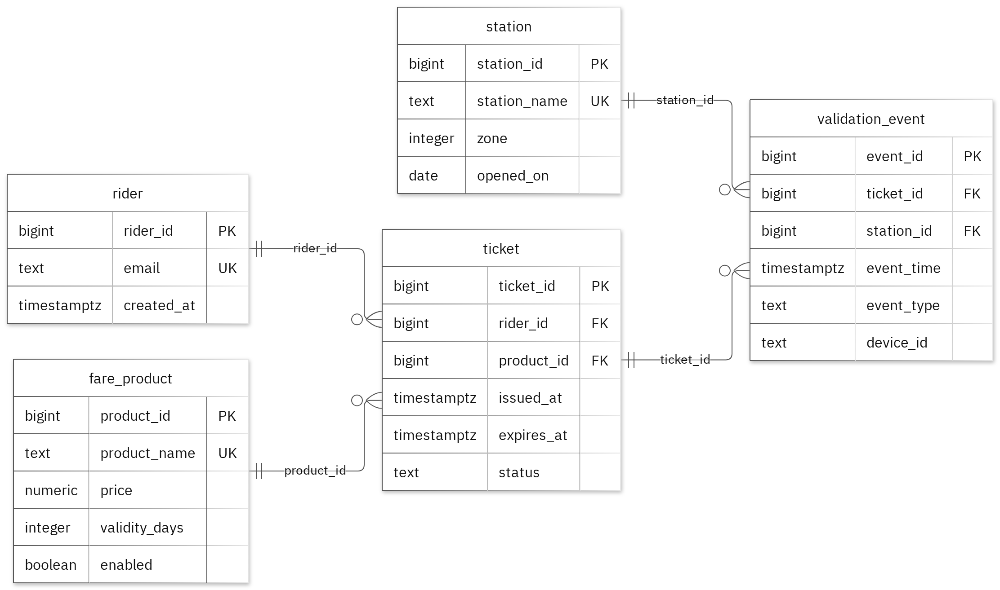

# MIT 8103 Advanced Database Systems

**Public Transport / Metro Ticketing System** · Stanley Ezendiokwere · Student ID 301915953

## Case study

For this database case study, I architected a comprehensive relational schema for a metropolitan transit ticketing system. The solution models operational workflows for synthetic riders purchasing transit passes, station staff monitoring validation activity, and data analysts evaluating station utilization. Built around five core entities—stations, riders, fare products, tickets, and validation events—the system seamlessly supports end-to-end transit operations, including managing station infrastructure and fare tiers, issuing and tracking commuter tickets, logging entry and exit validation activity, and generating high-level usage analytics.

## Portfolio 1: Database Design and Modelling

Structurally, I organized the relational architecture into five dedicated tables. I enforced data integrity through primary keys for record identification, foreign keys to maintain referential transparency, and check constraints to uphold business logic. To handle edge cases—such as ensuring a commuter can only hold one active ticket at a time—I implemented a partial unique index on the rider_id for active statuses. The documentation walks through normalization examples demonstrating how the sample data transitions from 1NF through 3NF, while rigorous testing confirmed that all 40 deliberately invalid inserts were correctly rejected without compromising valid records.

Figure 1. Tables, keys and relationships. PK: primary key; FK: foreign key; UK: unique value.

<!-- PAGE BREAK -->

## Portfolio 2: Query Processing and Optimisation

I ran three SQL queries against the sample records. The join returned 1 rows and included rider201@example.test with Day Pass. For the index comparison, I used 50,000 separate performance rows. The median lookup time changed from 2.389 ms to 0.261 ms. Both phases returned the same records. The measured plan used the new index. These timings apply to this lookup and environment.

## Portfolio 3: Transactions and Concurrency

I used a temporary counter on ticket to test COMMIT, ROLLBACK and READ COMMITTED isolation. The uncommitted update remained hidden from the other session, and ROLLBACK restored the earlier committed value. Without locking, two increments left the counter at 2. With SELECT FOR UPDATE, Session B waited for Session A and the final value was 3. The helper is confined to this exercise; the case's original business fields stay unchanged.

## Portfolio 4: NoSQL and Advanced Data Models

I used ticket_events for the case's event documents. MongoDB inserted 2 sample events and returned the expected results for 4 queries. Validation rejected an invalid date type and a duplicate event ID. Embedded snapshots keep related details with an event, while the details field can differ by event type. These are fictional events; PostgreSQL continues to enforce its relational rules.

## Repository and evidence

https://github.com/iamezendiokwerestanley/Ezendiokwere_Stanley_301915953

The portfolio folders contain the SQL and JavaScript, explanations, query plans, result tables and screenshots.

<!-- PAGE BREAK -->

## Portfolio 5: Distributed and Cloud Database Exercise

I proposed three MongoDB replica members across separate failure zones. The discussion covers primary elections, majority acknowledgement, secondary lag and sharding trade-offs for ticket_events. Replication supports availability, while backups address recovery. PostgreSQL needs its own availability plan. This is the permitted discussion option; no live replica set or failover test was deployed.

## Individual reflection

I kept station, rider, fare_product, ticket, validation_event in separate tables so their details could be maintained without repeating them in every related record. A rider may have at most one ticket whose status is active, enforced by a partial unique index on rider_id for active tickets. The constraint tests check this alongside the required values and record links. One issue illustrated by the two-session exercise is that both sessions can read the same value before either update is committed. Locking the row before reading preserves both increments. The index comparison also shows why I need to check the execution plan as well as the final answer: the same result can require different amounts of database work.

## AI-use declaration

I used GitHub Copilot and the portfolio generator to help prepare the database model, scripts and explanations. The generator ran the PostgreSQL and MongoDB exercises, checked their outputs and captured the result images.  I remain responsible for checking and explaining the submitted work.

## References

- [PostgreSQL: constraints](https://www.postgresql.org/docs/17/ddl-constraints.html)
- [PostgreSQL: EXPLAIN](https://www.postgresql.org/docs/17/using-explain.html)
- [PostgreSQL: isolation](https://www.postgresql.org/docs/17/transaction-iso.html)
- [PostgreSQL: row locks](https://www.postgresql.org/docs/17/explicit-locking.html)
- [MongoDB: data modelling](https://www.mongodb.com/docs/manual/data-modeling/)
- [MongoDB: replication](https://www.mongodb.com/docs/manual/replication/)
- [MongoDB: sharding](https://www.mongodb.com/docs/manual/sharding/)
- [Mermaid: ER diagrams](https://mermaid.js.org/syntax/entityRelationshipDiagram.html)

